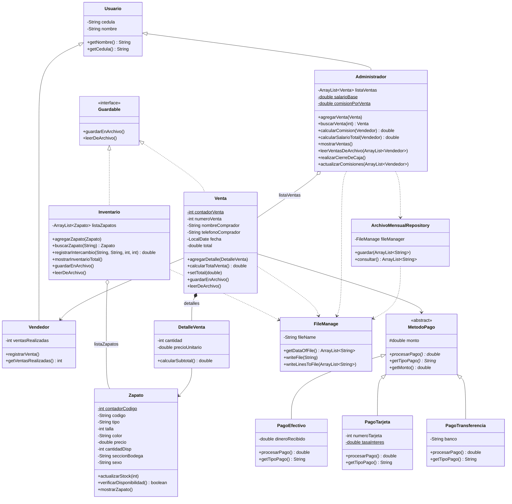

# CalzaTodo: sistema de ventas e inventario

Programa de consola en Java para la tienda de zapatos CalzaTodo. Permite registrar ventas e intercambios, consultar y actualizar el inventario, hacer el cierre de caja del día y calcular las comisiones y el salario de los vendedores. Los datos se guardan en archivos `.txt`.

Proyecto integrador del curso **Programación Orientada a Objetos (POO)**, Universidad de La Sabana, 2026.

## Integrantes

| Nombre | GitHub |
|---|---|
| María José López Sánchez | [majolosa1408-a11y](https://github.com/majolosa1408-a11y) |
| María Paula Gómez Mateus | [PAU1724](https://github.com/PAU1724) |
| Andrés Felipe Peña Cristancho | [Andrespe28](https://github.com/Andrespe28) |
| David Eduardo Díaz Arciniegas | [sarchyx6](https://github.com/sarchyx6) |

## Objetivo

Aplicar herencia, polimorfismo, encapsulamiento, abstracción e interfaces en un caso real: una tienda con dos roles (vendedor y administrador), varios medios de pago y un inventario. También mostrar cómo se combinan los datos en memoria (`ArrayList`) con el almacenamiento permanente en archivos de texto.

---

## Contenido

1. [Qué hace el sistema](#qué-hace-el-sistema)
2. [Cómo ejecutar el proyecto](#cómo-ejecutar-el-proyecto)
3. [Uso de los menús](#uso-de-los-menús)
4. [Estructura del proyecto](#estructura-del-proyecto)
5. [Arquitectura](#arquitectura)
6. [Diagrama de clases](#diagrama-de-clases)
7. [Conceptos de POO aplicados](#conceptos-de-poo-aplicados)
8. [Formato de los archivos de datos](#formato-de-los-archivos-de-datos)
9. [ArrayList vs archivo de texto](#arraylist-vs-archivo-de-texto)
10. [Reglas de negocio](#reglas-de-negocio)

---

## Qué hace el sistema

**Vendedor**
- Consultar el inventario completo o un zapato por código.
- Registrar una venta con uno o varios productos y cobrarla en efectivo, tarjeta o transferencia.
- Registrar un intercambio de productos y cobrar la diferencia si el nuevo es más caro.
- Consultar el nombre y teléfono del comprador a partir del número de venta.
- Buscar en qué sección de la bodega está un producto.
- Hacer el cierre de caja del día.

**Administrador**
- Ver las ventas, comisiones y salario total de cada vendedor.
- Ver el registro de ventas.
- Agregar unidades a un zapato existente o crear un zapato nuevo.

### Entidades principales

| Clase | Qué representa |
|---|---|
| `Usuario` | Persona que usa el sistema (cédula y nombre). Es la clase padre de `Vendedor` y `Administrador`. |
| `Vendedor` | Registra ventas. Lleva la cuenta de cuántas ventas ha hecho. |
| `Administrador` | Guarda la lista de ventas, calcula comisiones y salarios, carga las ventas desde archivo y hace el cierre de caja. |
| `Zapato` | Producto: código, tipo, talla, color, precio, unidades disponibles, sección de bodega y sexo. |
| `Inventario` | Lista de zapatos (`listaZapatos`) con búsqueda, intercambios y lectura/escritura en archivo. |
| `Venta` | Una venta: número, comprador, teléfono, vendedor, fecha, productos (`DetalleVenta`), método de pago y total. |
| `Venta.DetalleVenta` | Una línea de la venta: zapato, cantidad y precio unitario. |
| `MetodoPago` | Clase abstracta para los medios de pago: `PagoEfectivo`, `PagoTarjeta`, `PagoTransferencia`. |
| `FileManage` | Lee y escribe líneas en los archivos de `src/files/`. |

---

## Cómo ejecutar el proyecto

### Requisitos

- JDK 8 o superior. El proyecto está configurado en IntelliJ con OpenJDK 27, pero solo usa la biblioteca estándar (`java.util`, `java.io`, `java.time`).
- No tiene dependencias externas.

> **Importante:** las rutas de los archivos son relativas (`src/files/...`). El programa se debe ejecutar desde la **carpeta raíz del proyecto**. Si se ejecuta desde otra carpeta, no encuentra los `.txt`.

### Opción 1: IntelliJ IDEA

1. Abrir la carpeta `proyecto-integrador` como proyecto.
2. Verificar que haya un JDK configurado en *File → Project Structure → Project SDK*.
3. Ejecutar `src/Main.java`. IntelliJ usa la raíz del proyecto como directorio de trabajo por defecto.

### Opción 2: terminal

Desde la raíz del proyecto:

**Linux / macOS / Git Bash**
```bash
javac -encoding UTF-8 -d out $(find src -name "*.java")
java -cp out Main
```

**Windows (PowerShell)**
```powershell
javac -encoding UTF-8 -d out (Get-ChildItem -Recurse src -Filter *.java).FullName
java -cp out Main
```

La carpeta `out/` está en `.gitignore`, así que los `.class` compilados no se suben al repositorio.

### Usuarios de prueba

Los usuarios están definidos en `Menu.iniciarMenu()`. No hay inicio de sesión: al registrar una venta se escribe el nombre del vendedor (sin importar mayúsculas).

| Rol | Nombre | Cédula |
|---|---|---|
| Vendedor | Paula | 35400000 |
| Vendedor | Majo | 11000000 |
| Vendedor | Andres | 50100000 |
| Administrador | David | 12000000 |

---

## Uso de los menús

### Menú principal

```
------------------------------
          CALZATODO
------------------------------
1. Menú Vendedor.
2. Menú Administrador.
0. Salir
```

### Menú vendedor

| Opción | Acción |
|---|---|
| 1 | Consultar inventario: por código o el inventario completo. |
| 2 | Registrar intercambio: códigos y cantidades del producto que devuelve el cliente y del que se lleva. Si el nuevo es más caro, se registra una venta por la diferencia. |
| 3 | Registrar venta: vendedor, comprador, teléfono, productos (código y cantidad, se pueden agregar varios) y método de pago. |
| 4 | Consultar datos del comprador a partir del número de venta. |
| 5 | Buscar la sección de bodega de un producto. |
| 6 | Cierre de caja del día. |
| 0 | Volver al menú principal. |

### Menú administrador

| Opción | Acción |
|---|---|
| 1 | Ver datos: **1.** salario total de cada vendedor (ventas realizadas, comisión, salario base y total acumulado) o **2.** registro de todas las ventas. |
| 2 | Registrar producto: **1.** sumar unidades a un zapato existente o **2.** crear un zapato nuevo (el código se genera solo). |
| 3 | Generar Archivo mensual. |
| 4 | Consultar Archivo mensual. |
| 0 | Volver al menú principal. |

### Ejemplo: cierre de caja

Con las 4 ventas de ejemplo de `ventas.txt`, todas del mismo día:

```
==========================================
       CIERRE DE CAJA - 2026-11-24
==========================================
Total de ventas realizadas: 4
Total Efectivo:      $200000.0
Total Tarjeta:       $510000.0
Total Transferencia: $0.0
------------------------------------------
TOTAL RECAUDADO:      $710000.0
------------------------------------------
```

---

## Estructura del proyecto

```
proyecto-integrador/
├── src/
   ├── Main.java                                Punto de entrada. Crea el Menu y lo inicia.
   │
   ├── ui/
   │   ├── Menu.java                            Menú principal. Crea vendedores y administrador,
   │   │                                        carga inventario y ventas, y abre los submenús.
   │   ├── MenuVendedor.java                    Opciones del vendedor (ventas, intercambios, cierre de caja).
   │   └── MenuAdmi.java                        Opciones del administrador (salarios, ventas, productos).
   │
   ├── modelos/
   │   ├── Usuario.java                         Clase padre de Vendedor y Administrador.
   │   ├── Vendedor.java
   │   ├── Administrador.java
   │   ├── Zapato.java
   │   ├── Inventario.java                      Implementa Guardable.
   │   ├── Venta.java                           Implementa Guardable. Contiene la clase interna DetalleVenta.
   │   ├── MetodoPago.java                      Clase abstracta.
   │   ├── PagoEfectivo.java
   │   ├── PagoTarjeta.java
   │   └── PagoTransferencia.java
   │
   ├── interfaces/
   │   └── Guardable.java                       Contrato: guardarEnArchivo() y leerDeArchivo().
   │
   ├── persistencia/
   │   └── FileManage.java                      Leer y agregar líneas en los .txt.
   │
   ├── repositorios/
   │   └── ArchivoMensualRepository.java        Gestiona la lectura y escritura de Archivo_Mensual.txt
   │
   └── files/
       ├── inventario_zapatos.txt               5 zapatos de ejemplo.
       ├── ventas.txt                           8 ventas de ejemplo.
       ├── comisiones.txt                       3 líneas, una por vendedor (se regenera al iniciar).
       └── Archivo_Mensual.txt                  Información sobre las ventas e inventario del mes.

```

---

## Arquitectura

El código está separado en tres capas, una por paquete:

| Capa | Paquete | Responsabilidad |
|---|---|---|
| Interfaz (consola) | `ui` | Mostrar menús, leer lo que escribe el usuario y llamar a los métodos del modelo. |
| Dominio | `modelos` | Entidades, cálculos (totales, comisiones, cambio) y validaciones. |
| Persistencia | `persistencia`, `interfaces`, `repositorios` | Leer y escribir líneas en los archivos `.txt`. |

Algunas clases del modelo también imprimen en consola (por ejemplo `Zapato.mostrarZapato()` y `Administrador.realizarCierreDeCaja()`), así que la separación entre capas no es estricta.

### Al iniciar el programa

1. `Menu()` crea el `Inventario` y llama a `leerDeArchivo()`, que carga `inventario_zapatos.txt` en `listaZapatos`.
2. `iniciarMenu()` crea los 3 vendedores y el administrador.
3. `Administrador.leerVentasDeArchivo()` carga `ventas.txt` en `listaVentas` y suma una venta a cada vendedor según el nombre guardado.
4. `Administrador.actualizarComisiones()` reescribe `comisiones.txt` con los datos recién cargados.

### Flujo de una venta (opción 3 del menú vendedor)

```
Vendedor en consola
  │  Nombre del vendedor, comprador y teléfono
  ▼
MenuVendedor
  │  Busca el Vendedor por nombre y crea la Venta (número consecutivo, fecha de hoy)
  ▼
Por cada producto
  │  1. Inventario.buscarZapato(codigo)
  │  2. Valida que la cantidad sea > 0 y no supere el stock
  │  3. Zapato.actualizarStock(-cantidad) y guarda inventario_zapatos.txt
  │  4. Crea un DetalleVenta y lo agrega a la Venta
  ▼
Venta.calcularTotalVenta()  →  suma de los subtotales
  ▼
Método de pago (MetodoPago)
  │  Efectivo:       valida el dinero recibido y calcula el cambio
  │  Tarjeta:        total + 2 % de recargo
  │  Transferencia:  total sin cambios
  ▼
Registro
  │  1. vendedor.registrarVenta()               (+1 venta al vendedor)
  │  2. administrador.agregarVenta(venta)       (se agrega a listaVentas)
  │  3. venta.guardarEnArchivo()                (agrega una línea a ventas.txt)
  │  4. inventario.guardarEnArchivo()           (reescribe inventario_zapatos.txt)
  │  5. administrador.actualizarComisiones()    (reescribe comisiones.txt)
  ▼
Archivos .txt actualizados
```

---

## Diagrama de clases

GitHub muestra este diagrama directamente. Los miembros estáticos aparecen subrayados y los métodos abstractos en cursiva.



**Cómo leer las flechas**

| Símbolo | Relación | Ejemplo |
|---|---|---|
| `<\|--` | Herencia | `Vendedor` hereda de `Usuario` |
| `<\|..` | Implementa una interfaz | `Venta` implementa `Guardable` |
| `*--` | Composición (la parte no existe sin el todo) | `Venta` y `DetalleVenta` |
| `o--` | Agregación (el todo agrupa partes independientes) | `Inventario` y `Zapato` |
| `-->` | Asociación | `Venta` conoce a su `Vendedor` |
| `..>` | Dependencia (usa la clase) | `Inventario` usa `FileManage` |

---

## Conceptos de POO aplicados

### Herencia

```
Usuario
├── Vendedor
└── Administrador

MetodoPago (abstracta)
├── PagoEfectivo
├── PagoTarjeta
└── PagoTransferencia
```

- `Vendedor` y `Administrador` heredan `cedula` y `nombre` de `Usuario` y los inicializan con `super(cedula, nombre)`.
- `Vendedor` agrega el contador `ventasRealizadas`.
- `Administrador` agrega la lista de ventas, el cálculo de comisiones y salarios, y el cierre de caja.

### Abstracción

`MetodoPago` es una clase abstracta: no se puede instanciar y obliga a cada medio de pago a implementar dos métodos:

- `procesarPago()`: hace el cobro y devuelve un valor (el cambio en efectivo, o el total cobrado en tarjeta y transferencia).
- `getTipoPago()`: devuelve `"Efectivo"`, `"Tarjeta"` o `"Transferencia"`.

El atributo común `monto` y su validación están en la clase padre.

### Polimorfismo

Una variable de tipo `MetodoPago` puede guardar cualquiera de los tres pagos, y cada uno responde a `procesarPago()` a su manera:

```java
MetodoPago efectivo      = new PagoEfectivo(60000, 50000);             // dinero recibido, monto
MetodoPago tarjeta       = new PagoTarjeta(50000, 1234);               // monto, número de tarjeta
MetodoPago transferencia = new PagoTransferencia("Bancolombia", 50000); // banco, monto

efectivo.procesarPago();       // 10000.0 (el cambio)
tarjeta.procesarPago();        // 51000.0 (monto + 2 %)
transferencia.procesarPago();  // 50000.0

efectivo.getTipoPago();        // "Efectivo"
tarjeta.getTipoPago();         // "Tarjeta"
transferencia.getTipoPago();   // "Transferencia"
```

Dónde se usa en el proyecto:

- `Administrador.realizarCierreDeCaja()` suma los montos por medio de pago con `getTipoPago()`, sin usar `instanceof`.
- `Administrador.leerVentasDeArchivo()` crea el pago correcto según el texto guardado y lo asigna a una variable `MetodoPago`.

### Encapsulamiento

Los atributos son `private` (o `protected` en `MetodoPago.monto`) y se acceden con getters. Los cambios de estado pasan por validaciones:

| Dónde | Qué valida |
|---|---|
| Constructor de `MetodoPago` | Si el monto es negativo, asigna 0. |
| `PagoEfectivo.procesarPago()` | El dinero recibido no puede ser menor que el monto. Si lo es, devuelve `-1`. |
| `Venta.setTotal()` | El total no puede ser negativo. |
| `Zapato.actualizarStock()` | El stock no puede quedar negativo. |

### Interfaces

| Interfaz | Métodos | La implementan |
|---|---|---|
| `Guardable` | `guardarEnArchivo()`, `leerDeArchivo()` | `Inventario`, `Venta` |

Cada clase guarda de forma distinta:

- `Inventario.guardarEnArchivo()` **reescribe** el archivo completo con todos los zapatos.
- `Venta.guardarEnArchivo()` **agrega** una línea al final de `ventas.txt`.

### Clase interna

`DetalleVenta` está declarada dentro de `Venta` porque una línea de detalle no tiene sentido sin su venta. Es una clase interna no estática, así que se crea a partir de una venta existente:

```java
Venta.DetalleVenta detalle = venta.new DetalleVenta(cantidad, zapato);
venta.agregarDetalle(detalle);
```

### Composición, agregación y asociación

- **Composición:** `Venta` contiene sus `DetalleVenta`. Se crean con la venta y no existen fuera de ella.
- **Agregación:** `Inventario` agrupa objetos `Zapato` y `Administrador` agrupa objetos `Venta`.
- **Asociación:** cada `Venta` tiene un `Vendedor` y un `MetodoPago`.

### Miembros estáticos

| Clase | Miembro | Uso |
|---|---|---|
| `Venta` | `contadorVenta` | Consecutivo que asigna el número de cada venta. |
| `Zapato` | `contadorCodigo` | Consecutivo para generar el código de 4 dígitos de los zapatos nuevos. |
| `Administrador` | `salarioBase` | Salario base de los vendedores ($2.000.000). |
| `Administrador` | `comisionPorVenta` (`final`) | Comisión fija por venta ($3.000). |
| `PagoTarjeta` | `tasaInteres` | Recargo de las ventas con tarjeta (2 %). |

Estos valores son de la clase, no de cada objeto: todas las ventas comparten el mismo contador y todos los vendedores la misma comisión.

---

## Formato de los archivos de datos

Todos los archivos están en `src/files/`. Cada línea es un registro y los campos van separados por `|`.

### `inventario_zapatos.txt`

```
codigo|tipo|talla|color|precio|cantidadDisp|seccionBodega|sexo
```

| Campo | Tipo | Ejemplo |
|---|---|---|
| `codigo` | Texto de 4 dígitos | `0001` |
| `tipo` | Texto | `Tenis` |
| `talla` | Entero | `37` |
| `color` | Texto | `Negro` |
| `precio` | Decimal | `150000.0` |
| `cantidadDisp` | Entero | `13` |
| `seccionBodega` | Texto | `A` |
| `sexo` | Texto | `Mujer` |

```
0001|Tenis|37|Negro|150000.0|13|A|Mujer
0002|Deportivo|41|Verde|200000.0|7|A|Hombre
```

### `ventas.txt`

```
numeroVenta|comprador|telefono|vendedor|total|fecha|metodoPago
```

| Campo | Tipo | Ejemplo |
|---|---|---|
| `numeroVenta` | Entero | `1` |
| `comprador` | Texto | `Pepito` |
| `telefono` | Texto | `325698417` |
| `vendedor` | Nombre del vendedor | `Andres` |
| `total` | Decimal | `610000.0` |
| `fecha` | `AAAA-MM-DD` | `2026-11-21` |
| `metodoPago` | Nombre de la clase | `PagoEfectivo`, `PagoTarjeta` o `PagoTransferencia` |

```
1|Pepito|325698417|Andres|610000.0|2026-11-21|PagoEfectivo
2|Ana|3256987541|Majo|581400.0|2026-11-21|PagoTarjeta
```

Al leer el archivo también se aceptan los valores cortos `Efectivo`, `Tarjeta` y `Transferencia`. Si el vendedor de una línea no existe en el sistema, esa venta se ignora.

### `comisiones.txt`

```
vendedor|ventasRealizadas|comision
```

```
Paula|1|3000.0
Majo|1|3000.0
Andres|2|6000.0
```

Este archivo se calcula a partir de `ventas.txt`. Se reescribe al iniciar el programa y después de cada venta, así que editarlo a mano no tiene efecto.

### `Archivo_Mensual.txt`

El `Administrador` genera y consulta el informe mensual a partir de las ventas y el inventario. 

---

## ArrayList vs archivo de texto

El programa trabaja con dos tipos de almacenamiento:

| | `ArrayList` | Archivo `.txt` |
|---|---|---|
| Dónde vive | Memoria RAM | Disco |
| Duración | Mientras el programa está abierto | Permanente |
| Acceso | Directo a objetos (`zapato.getPrecio()`) | Hay que leer líneas y convertir cada campo con `split("\\|")` y `parseInt`/`parseDouble` |
| Para qué se usa | Buscar, modificar y calcular | Conservar los datos entre ejecuciones |

La idea es: al iniciar, se leen los archivos y se convierten en objetos dentro de listas. Durante la ejecución se trabaja sobre las listas. Después de cada cambio, se escribe de vuelta en el archivo.

| Lista en memoria | Clase | Archivo | Cuándo se lee | Cuándo se escribe |
|---|---|---|---|---|
| `listaZapatos` | `Inventario` | `inventario_zapatos.txt` | Al iniciar (`Menu()`) | Después de cada venta, intercambio o cambio de stock (reescribe todo) |
| `listaVentas` | `Administrador` | `ventas.txt` | Al iniciar (`leerVentasDeArchivo()`) | Después de cada venta (agrega una línea) |
| `vendedores` | `Menu` | `comisiones.txt` | No se lee | Al iniciar y después de cada venta (reescribe todo) |
| `detalles` | `Venta` | Ninguno | — | No se guarda |

Las dos formas de escribir están en `FileManage`:

- `writeFile(linea)` abre el archivo en modo *append* y agrega una línea al final. La usa `Venta`.
- `writeLinesToFile(lineas)` borra el contenido y escribe todas las líneas de nuevo. La usan `Inventario` y `Administrador.actualizarComisiones()`.

---

## Reglas de negocio

**Ventas**
- El vendedor debe existir; se busca por nombre sin importar mayúsculas.
- La cantidad de cada producto debe ser mayor que 0 y no puede superar las unidades disponibles.
- El stock se descuenta en el momento en que se agrega cada producto a la venta.
- El total es la suma de `cantidad × precio unitario` de cada producto.
- El número de venta es consecutivo. Al iniciar, el contador sigue desde la cantidad de ventas cargadas de `ventas.txt`.
- La fecha de la venta es la fecha del sistema.

**Medios de pago**
- **Efectivo:** se solicita el dinero recibido y se valida que cubra el total. Si es insuficiente, solicita ingresar un nuevo monto. El proceso vuelve a solicitar un monto incluso cuando el primero es suficiente. Si el pago es válido, se muestra el cambio.
- **Tarjeta:** se cobra un recargo del 2 % y el total guardado incluye ese recargo.
- **Transferencia:** se pide el nombre del banco y se cobra el total sin recargo.

**Intercambios**
- El cliente devuelve unidades del producto 1 (se suman al stock) y se lleva unidades del producto 2 (se restan del stock).
- La diferencia se calcula teniendo en cuenta los precios unitarios y las cantidades: `(precio del producto 2 × cantidad del producto 1) − (precio del producto 1 × cantidad del producto 2)`.
- Si la diferencia es mayor que 0, se registra una venta por ese valor y cuenta para la comisión del vendedor.
- Si la diferencia es 0 o negativa, no se registra la venta.

**Comisiones y salario**
- Comisión: $3.000 por cada venta registrada (incluye las ventas por intercambio).
- Salario total = $2.000.000 de salario base + comisión.

**Inventario**
- El código de un zapato nuevo se genera solo, con 4 dígitos, a partir del código más alto cargado (si el último es `0004`, el siguiente es `0005`).
- Para sumar unidades a un zapato existente, la cantidad debe ser mayor que 0.
- El stock nunca puede quedar negativo.

**Cierre de caja**
- Solo incluye las ventas con fecha de hoy.
- Muestra el total por medio de pago (efectivo, tarjeta, transferencia) y el total recaudado.

---

